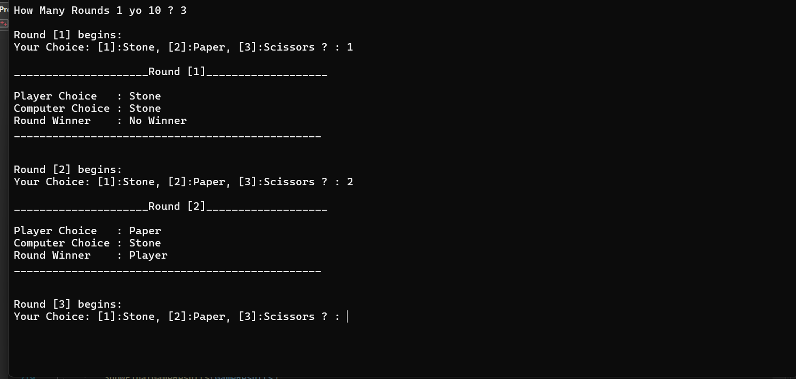

# Rock Paper Scissors Game

A console-based Rock, Paper, Scissors game written in C++[span_0](start_span)[span_0](end_span). The player competes against the computer across multiple rounds with real-time score tracking.

## Features
- Choose the number of rounds (1 to 10) per match.
- Randomized computer choices using rand().
- Round-by-round result display and final match summary.
- Input validation to handle invalid entries.
- Option to replay after finishing a match.

## Concepts Used
- Functions & Modular Design
- Enumerations (enum) & Structures (struct)
- Loops & Conditional Statements
- Random Number Generation

## How to Run
1. Clone the repository:
   `bash
   git clone [https://github.com/AmrMoussa11dev/Rock-paper-scissors-game.git](https://github.com/AmrMoussa11dev/Rock-paper-scissors-game.git)

## 📸Sample Gameplay

